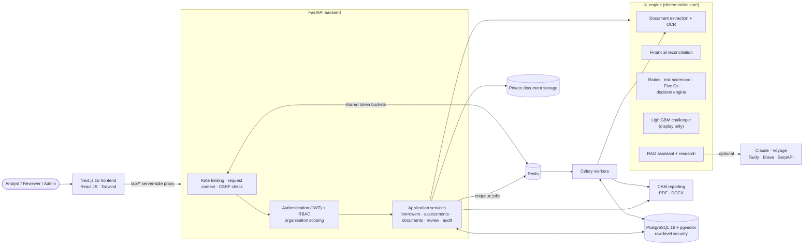
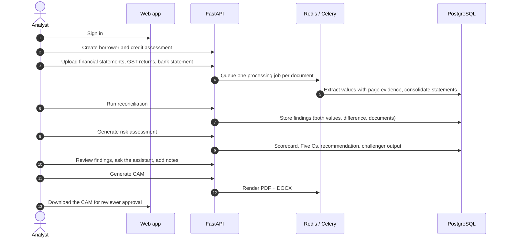
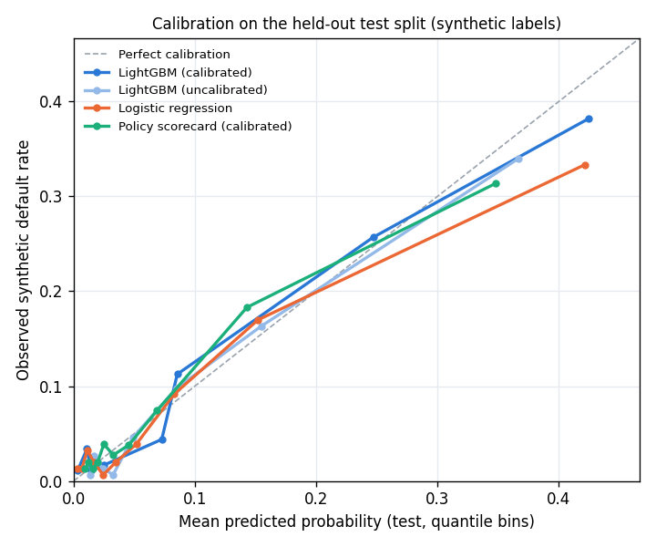
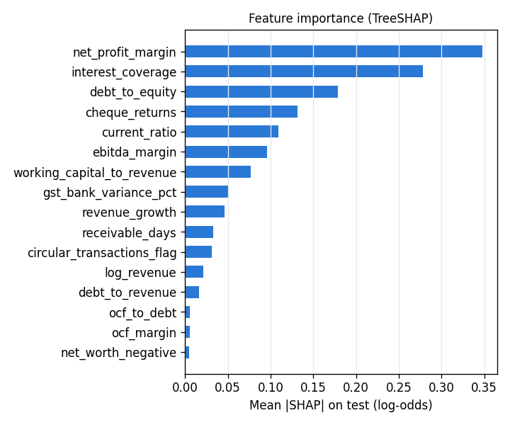

<div align="center">

# Intelli-Credit

**AI-Powered MSME Credit Assessment & Financial Due-Diligence Platform**

An intelligent financial assessment platform designed to help lenders and credit analysts evaluate MSME financial
documents, identify inconsistencies, understand financial risk and generate evidence-supported Credit Appraisal Memos.


</div>

> [!IMPORTANT]
> **Decision support only.** Intelli-Credit never approves or rejects a loan by itself. Scores come from a
> transparent policy scorecard (not a calibrated probability of default), indicative rates are illustrative, and
> reconciliation findings are *potential discrepancies* or *items requiring verification* — never findings of fraud.
> All demo borrowers, documents and ML training data are **synthetic**.

## 📑 Table of contents

- [Overview](#-overview)
- [Key features](#-key-features)
- [Architecture](#-architecture)
- [Application workflow](#-application-workflow)
- [Technology stack](#-technology-stack)
- [Machine learning challenger](#-machine-learning-challenger)
- [Screenshots](#-screenshots)
- [Repository structure](#-repository-structure)
- [Getting started](#-getting-started)
- [Running tests](#-running-tests)
- [Configuration](#-configuration)
- [Security](#-security)
- [API overview](#-api-overview)
- [Operations and deployment](#-operations-and-deployment)
- [Verification status](#-verification-status)
- [Limitations and responsible AI](#-limitations-and-responsible-ai)
- [Roadmap](#-roadmap)
- [About](#-about)

## 🔎 Overview

**What it does.** Analysts upload a borrower's financial statements, GST returns and bank statements. Intelli-Credit
extracts the figures with page-level evidence, normalises Indian number formats and fiscal years, reconciles the
sources against each other, computes financial ratios, scores credit risk with an explainable policy scorecard,
proposes a policy-driven recommendation (amount, rate, tenure, conditions) and generates a Credit Appraisal Memo
(CAM) for **authorised human review**.

**The problem.** MSME credit appraisal is document-heavy and manual. Figures are spread across audited statements,
GSTR-3B/2A returns and bank statements in different units (₹, lakh, crore) and formats, including scans. Analysts
must re-key numbers, cross-check sources and justify every conclusion in a memo.

**Intended users.** Credit analysts, credit reviewers/approvers and administrators at banks, NBFCs and other MSME
lenders.

**Why reconciliation matters.** Declared turnover that is not supported by GST filings or bank receipts, round-trip
transfers, excess input-tax credit or frequent cheque returns are classic early-warning signals. Intelli-Credit
compares the sources systematically and presents each difference with both values, the documents involved and a
suggested verification step, so the analyst decides what it means.

**What makes it technically interesting**

- Deterministic, evidence-linked extraction: every number points back to a document, page and confidence.
- Multi-tenant isolation enforced twice: in the API **and** by PostgreSQL row-level security through a non-superuser role.
- An explainable scorecard with a separately reported confidence indicator, plus an isolated, versioned ML challenger.
- Citation-checked RAG answers (structured outputs when Claude is configured, an extractive fallback when not).
- Asynchronous processing with atomic job claims, retries, crash recovery and per-application concurrency control.
- Distributed rate limiting with an atomic Redis token-bucket script shared by all API instances.

## ✨ Key features

### 📄 Document intelligence

| Feature | What is implemented |
|---|---|
| **Financial document intelligence** | Upload PDF, DOCX, XLSX, CSV and images; automatic classification (financial statements, GST returns, bank statements, annual reports, ITRs, …); extraction of statement line items with page evidence and confidence |
| **OCR and extraction** | Text-layer parsing (PyMuPDF, pdfplumber) with OCR fallback for scanned pages — Tesseract if installed, otherwise the bundled RapidOCR |
| **Indian financial data normalisation** | ₹ / lakh / crore units, Indian digit grouping, negative-number conventions, FY labels (FY2023-24) and period ends; missing values stay missing — never zero-filled |
| **GST and bank reconciliation** | 12 checks, e.g. GST turnover vs bank receipts, GST vs financial statements, ITC claimed vs available, round-trip transactions, cash deposits, cheque returns; each finding shows both values, the difference and the source documents |

### 📊 Analysis and decisioning

| Feature | What is implemented |
|---|---|
| **Financial ratio analysis** | Liquidity, leverage, profitability, efficiency and cash-flow ratios with safe denominators, formulas, inputs and source references |
| **Explainable credit risk scoring** | 9-dimension policy scorecard with weighted factors, red flags, missing-information list and a confidence indicator reported separately from the score |
| **Five Cs of Credit** | Character, capacity, capital, collateral and conditions derived from the same evidence |
| **Credit recommendation engine** | Outcome, amount caps (turnover, DSCR, collateral, policy), rate build-up, tenure, repayment capacity, conditions precedent; the recommended amount never exceeds the request |
| **AI document assistant** | Questions answered from the application's own figures, findings and document passages, each answer cited; unsupported questions are marked as not verifiable |
| **Financial due diligence** | Research findings with source tier, publication and retrieval time; field observations with interpretation and reviewer status |

### 🧾 Reporting, review and governance

| Feature | What is implemented |
|---|---|
| **CAM PDF and DOCX** | ReportLab PDF and python-docx DOCX: cover page and 24 sections with basis labels (extracted / computed / model / analyst …), evidence references and review status; figures come only from persisted records |
| **Human review and approval** | Reviewer decisions with mandatory justification, segregation of duties (no approving your own assessment), comments and notifications |
| **Organisation-level security** | Every record belongs to an organisation; cross-tenant IDs return 404; PostgreSQL RLS as a second layer |
| **Audit trails** | Sensitive actions recorded in an append-only audit log (database triggers reject `UPDATE`/`DELETE`) |
| **ML challenger evaluation** | LightGBM model scored next to the scorecard in a separate *experimental — not used for decisions* card |
| **Background processing and recovery** | Thread pool or Celery + Redis workers; atomic job claims, retries with backoff, idempotent re-processing, recovery of orphaned jobs |

### 🔌 Optional integrations

The platform is fully usable without any external service. These activate when credentials are configured:

| Integration | With credentials | Without credentials |
|---|---|---|
| Anthropic Claude | Assistant answers via structured outputs, citations checked against supplied sources | Extractive, cited answers |
| Voyage embeddings | Semantic retrieval | Local hashing embedder (no network) |
| Tavily / Brave / SerpAPI | External research with sources | Recorded as *not configured*; nothing presented as verified |

## 🏗️ Architecture



| Layer | Path | Responsibility |
|---|---|---|
| Frontend | `frontend/` | Dashboard, borrowers, assessment wizard, 9-step workspace, settings; calls the API through a server-side proxy |
| API | `backend/app/` | Auth, RBAC, tenant scoping, services that persist every engine output, jobs, audit |
| AI engine | `backend/ai_engine/` | Parsing, OCR, extraction, reconciliation, ratios, scorecard, decision engine, RAG, providers, ML challenger |
| Reporting | `backend/reporting/` | CAM PDF and DOCX renderers |
| Database | `backend/migrations/` | Alembic: 35 tables, RLS policies, append-only triggers |

## 🔄 Application workflow



1. **Sign in** — session in an httpOnly cookie; role determines what the user can do.
2. **Create a borrower** — company profile, identifiers (PAN, GSTIN, CIN), directors and promoters.
3. **Create a credit assessment** — loan type, amount, tenure, purpose, collateral, existing borrowings.
4. **Upload documents** — validated by size and magic bytes, stored privately.
5. **Asynchronous processing** — live progress per document; failures can be retried.
6. **Extraction** — statement values with page references and confidence; analysts can verify or correct them.
7. **Reconciliation** — discrepancies and unusual patterns, each with an analyst review status.
8. **Risk assessment** — 9 dimensions, red flags, missing information, confidence, Five Cs.
9. **Recommendation** — outcome, amount constraints, indicative rate, tenure and conditions.
10. **Analyst review** — notes, assistant questions with citations, due-diligence observations.
11. **CAM generation** — PDF and DOCX built from the persisted records.
12. **Download and decision** — a reviewer records the decision with justification; everything is audited.

## 🧰 Technology stack

| Area | Technologies |
|---|---|
| Frontend | Next.js 15.5, React 19, TypeScript 5.9, Tailwind CSS 3.4, TanStack Query 5, Recharts |
| Backend | Python 3.12, FastAPI 0.115, Pydantic 2, Uvicorn, SQLAlchemy 2.0, Alembic |
| Database | PostgreSQL 16, pgvector, row-level security |
| Background jobs | Celery 5.5 + Redis 7 (or an in-process thread pool) |
| Document processing | PyMuPDF, pdfplumber, python-docx, openpyxl |
| OCR | RapidOCR (ONNX Runtime, bundled), Tesseract via pytesseract when installed |
| AI / RAG | Anthropic SDK (Claude), Voyage embeddings, local hashing embedder, pgvector retrieval |
| Research | Tavily, Brave Search and SerpAPI clients (httpx) |
| ML | LightGBM 4.7, scikit-learn 1.6 (baselines, calibration), NumPy |
| Reporting | ReportLab (PDF), python-docx (DOCX) |
| Security | bcrypt, PyJWT, PostgreSQL RLS, Redis token-bucket rate limiting |
| Testing | pytest, Vitest + Testing Library, Playwright |
| Infrastructure | Docker, Docker Compose, nginx + Let's Encrypt on Google Compute Engine (primary target), alternative Cloud Run / Cloud SQL / Memorystore scripts |
| Observability | Structured JSON logs with request ids (Cloud Logging / Error Reporting compatible), `/health` and `/ready` endpoints |

## 🤖 Machine learning challenger

The **transparent policy scorecard remains the production decision-support mechanism.** A LightGBM challenger is
scored alongside it for comparison only; it never changes scores, recommendations, amounts, rates or tenures (a test
enforces this) and its artifact is marked `approved_for_decisions: false`.

**Dataset (`synthetic-credit-v1`).** 7,630 annual snapshots from 4,000 **synthetic** borrowers, with 591 synthetic
defaults (7.7 %). Four borrower profiles with different default rates, controlled GST/bank inconsistencies and
realistic missing values (kept missing). Labels come from a documented generator formula — see
[`data/ml/DATASET_CARD.md`](data/ml/DATASET_CARD.md).

**Pipeline.** Data validation → shared feature code (the production ratio engine) → borrower-level 60/20/20 split →
LightGBM with monotone constraints and early stopping → calibration chosen by cross-validation → threshold chosen on
validation → one evaluation on the untouched test split, with bootstrap intervals, TreeSHAP explanations and two
baselines. Fully deterministic and versioned.

**Results on the synthetic test split** (from
[`evaluation.md`](backend/models/challenger/challenger-lgbm-20261127-12af7e39/evaluation.md)):

| Model | ROC-AUC | PR-AUC | Brier |
|---|---:|---:|---:|
| LightGBM challenger (calibrated) | 0.830 | 0.320 | 0.0569 |
| Logistic regression baseline | 0.824 | 0.352 | 0.0586 |
| Policy scorecard (production) | 0.814 | 0.334 | 0.0584 |

Confidence intervals overlap and the ROC-AUC difference to the scorecard is not significant; the challenger has the
lowest PR-AUC. **On this synthetic data it is comparable to, not better than, the simpler baselines — and synthetic
performance does not establish any real-world credit prediction capability.**

<p align="center">
  
  
</p>

```bash
cd backend && .venv/bin/python -m app.cli ml-generate-data && .venv/bin/python -m app.cli ml-train
```

Details: [docs/ML_CHALLENGER.md](docs/ML_CHALLENGER.md).

## 🖼️ Screenshots

> [!NOTE]
> UI screenshots have not been captured yet. To add them, run the stack (see [Getting started](#-getting-started)),
> sign in with a demo account, and save PNGs to `docs/screenshots/` with these names, then link them here:

| Screen | Suggested file |
|---|---|
| Login | `docs/screenshots/login.png` |
| Dashboard | `docs/screenshots/dashboard.png` |
| Borrower management | `docs/screenshots/borrowers.png` |
| Document upload and processing | `docs/screenshots/documents.png` |
| Financial analysis | `docs/screenshots/financials.png` |
| Reconciliation findings | `docs/screenshots/reconciliation.png` |
| Credit-risk assessment | `docs/screenshots/risk.png` |
| CAM report preview | `docs/screenshots/cam.png` |

## 📁 Repository structure

```text
intelli/
├── backend/
│   ├── ai_engine/          # deterministic core: extraction, ocr, nlp, reconciliation, risk_model
│   │                       # (ratios, scorecard, challenger/), decision_engine, rag, embeddings, llm, research
│   ├── app/
│   │   ├── api/            # FastAPI routers and response serializers
│   │   ├── core/           # config, database + RLS context, security, rate limiting, logging, storage, errors
│   │   ├── models/         # SQLAlchemy models (35 tables)
│   │   ├── schemas/        # validated request bodies
│   │   ├── services/       # documents, jobs, financials, analysis, diligence, assistant, cam, challenger, audit
│   │   ├── seed/           # synthetic document generator and demo seed
│   │   ├── workers/        # Celery app and Cloud Run worker health endpoint
│   │   ├── cli.py          # management commands
│   │   └── main.py         # application entry point
│   ├── migrations/         # Alembic: 0001 schema, 0002 RLS + append-only triggers
│   ├── models/challenger/  # versioned ML artifacts (LATEST names the active one)
│   ├── reporting/          # CAM PDF and DOCX generators
│   ├── scripts/            # verify_stack.py, security_probe.py, check_providers.py
│   └── tests/              # pytest suites (live provider tests are opt-in)
├── frontend/
│   ├── src/                # app routes, components, API client, types
│   └── e2e/                # Playwright browser tests
├── data/
│   ├── synthetic/          # synthetic demo documents (three borrower cases)
│   └── ml/                 # synthetic labelled ML dataset + dataset card
├── deploy/compute-engine/  # Compute Engine VM: create-vm, bootstrap, env, deploy, nginx/TLS, verify, backups
├── deploy/gcp/             # alternative Cloud Run / Cloud SQL deployment (prepared, not deployed)
├── docs/                   # DEPLOYMENT_COMPUTE_ENGINE, BUILD_STATUS, OPERATIONS, PROVIDERS, ML_CHALLENGER
├── scripts/                # backup.sh, restore.sh
├── docker-compose.yml
├── docker-compose.prod.yml
└── .env.example
```

## 🚀 Getting started

### Prerequisites

- Docker Engine with the Compose v2 plugin (`docker compose version`)
- For local development without containers: Python 3.12 and Node.js 22

### Option A — Docker Compose (recommended)

```bash
cp .env.example .env
```

Edit `.env` and set at least `SECRET_KEY` and `APP_DB_PASSWORD` (never commit this file; it is git-ignored).

```bash
docker compose up -d --build
```

```bash
docker compose --profile seed run --rm seed
```

```bash
docker compose ps
```

The `migrate` service applies the Alembic migrations and creates the RLS-restricted database role automatically
before the API starts.

| Service | URL |
|---|---|
| Web app | http://localhost:3080 |
| API | http://localhost:8080/api/v1 |
| Interactive API docs (non-production only) | http://localhost:8080/api/docs |
| Readiness | http://localhost:8080/ready |

All host ports are bound to `127.0.0.1`; Redis is not published. Production overrides (secure cookies, no
registration, no exposed database/API ports, required secrets) are in `docker-compose.prod.yml`. For a production
server, generate the `.env` with `deploy/compute-engine/generate-env.sh <domain>` and follow
[docs/DEPLOYMENT_COMPUTE_ENGINE.md](docs/DEPLOYMENT_COMPUTE_ENGINE.md); the overlay is then selected automatically:

```bash
deploy/compute-engine/deploy.sh
```

HTTPS is required in production: the session cookie is `Secure`-only, so terminate TLS in front of the frontend
(the guide sets up nginx with Let's Encrypt).

### Option B — Local development

```bash
docker run -d --name intellicredit-dev-db -e POSTGRES_USER=intelli -e POSTGRES_PASSWORD=intelli_dev_pw \
  -e POSTGRES_DB=intellicredit -p 127.0.0.1:5433:5432 pgvector/pgvector:pg16
```

```bash
docker run -d --name intellicredit-dev-redis -p 127.0.0.1:6380:6379 redis:7-alpine
```

```bash
cp .env.example .env
```

```bash
cd backend && python3.12 -m venv .venv && .venv/bin/pip install -r requirements.txt && .venv/bin/alembic upgrade head && .venv/bin/python -m app.cli create-app-role && .venv/bin/python -m app.cli seed
```

```bash
cd backend && .venv/bin/uvicorn app.main:app --port 8001
```

```bash
cd frontend && npm install && npm run dev
```

Open http://localhost:3000 (API docs at http://localhost:8001/api/docs). Background processing uses an in-process
thread pool by default; set `JOB_BACKEND=celery` and start a worker for the Redis-backed path:

```bash
cd backend && .venv/bin/celery -A app.workers.celery_app worker --loglevel=INFO -Q intellicredit
```

### Demo accounts and synthetic data

The seed creates two organisations and pushes three **synthetic** borrower cases through the real pipeline.

| Account | Role | Organisation |
|---|---|---|
| `admin@meridian.example` | admin | Meridian Demo Bank (Synthetic) |
| `analyst@meridian.example` | analyst | Meridian Demo Bank (Synthetic) |
| `reviewer@meridian.example` | reviewer | Meridian Demo Bank (Synthetic) |
| `admin@northwind.example` | admin | Northwind Credit Union (Synthetic) — demonstrates tenant isolation |

All demo users share one password: `DEMO_PASSWORD` if set when seeding, otherwise the development default
`IntelliDemo2026!` (printed by the seed command). **Set your own `DEMO_PASSWORD` for any shared environment.**

| Case | Borrower (fictitious) | Demonstrates |
|---|---|---|
| `healthy` | Sahyadri Precision Components Pvt Ltd | Consistent revenue, moderate leverage, positive cash flow → low risk |
| `inconsistent` | Ganga Textile Traders Pvt Ltd | GST turnover far above bank receipts, round-trip transfers, excess ITC → conditional approval, findings to verify |
| `stressed` | Vindhya Agro Foods Pvt Ltd | Losses, negative net worth, cheque returns, going-concern note → rejection recommended |

The source documents are in `data/synthetic/<case>/` and can be uploaded through the UI to run the workflow yourself.

### Management commands (from `backend/`)

| Command | Purpose |
|---|---|
| `.venv/bin/alembic upgrade head` | Apply migrations |
| `.venv/bin/python -m app.cli create-app-role` | Create/refresh the RLS-restricted app role |
| `.venv/bin/python -m app.cli seed [--reset]` | Seed demo organisations, users and synthetic cases |
| `.venv/bin/python -m app.cli recover-jobs` | Re-queue jobs orphaned by a crash |
| `.venv/bin/python -m app.cli ml-generate-data` / `ml-train` | Build the synthetic ML dataset / train and version the challenger |
| `.venv/bin/python scripts/check_providers.py [--live]` | Provider configuration; `--live` makes real (billed) calls |

## 🧪 Running tests

```bash
cd backend && .venv/bin/python -m pytest -q
```

Runs against a real PostgreSQL test database (created and migrated automatically from the development server on
`:5433`; set `TEST_DATABASE_ADMIN_URL` to point elsewhere) and Redis on `:6380` for the distributed rate-limit tests.

```bash
cd frontend && npm test
```

```bash
cd frontend && npm run typecheck
```

```bash
cd frontend && npx playwright install chromium && npm run test:e2e
```

The browser tests build a production bundle on `:3100` and start the API on `:8001` against the seeded development
database.

Smoke and security checks against a running stack:

```bash
cd backend && DEMO_PASSWORD=<demo password> .venv/bin/python scripts/verify_stack.py --base http://localhost:3080
```

```bash
cd backend && DEMO_PASSWORD=<demo password> .venv/bin/python scripts/security_probe.py --base http://localhost:3080
```

`verify_stack.py` runs the full workflow (upload → processing → reconciliation → assessment → CAM download →
figures vs database → audit → tenant isolation). `security_probe.py` runs 42 live checks and ends with ~26 failed
logins for a non-existent account, so logins from your IP are throttled for up to a minute afterwards.

Optional live provider tests (real, billed calls; each skips with "credentials missing" without its key):

```bash
cd backend && IC_LIVE_TESTS=1 .venv/bin/python -m pytest -m live tests/test_live_providers.py -v -rs
```

## ⚙️ Configuration

All configuration is environment-driven and documented in [`.env.example`](.env.example).

- `DATABASE_URL` must use the **non-superuser** app role so row-level security applies; `MIGRATION_DATABASE_URL` is
  the owner account used only for migrations.
- `JOB_BACKEND`: `thread` (default), `celery` or `sync` (tests).
- `RATE_LIMIT_*`, `TRUSTED_PROXIES`: distributed rate limiting (see [Security](#-security)).
- `LLM_*`, `EMBEDDING_*`, `SEARCH_PROVIDER`, `TAVILY_API_KEY`, `BRAVE_API_KEY`, `SERPAPI_API_KEY`: optional providers —
  see [docs/PROVIDERS.md](docs/PROVIDERS.md).
- `CHALLENGER_ENABLED`, `CHALLENGER_MODEL_DIR`, `CHALLENGER_MODEL_VERSION`: the experimental ML challenger.

## 🔐 Security

| Control | Implementation |
|---|---|
| Authentication | bcrypt (12 rounds) password hashing; HS256 JWT sessions in an httpOnly, SameSite=Lax cookie (Secure in production) or a bearer token; server-side revocation on logout; CSRF header required for cookie-authenticated mutations |
| RBAC | Roles `admin`, `analyst`, `reviewer` enforced on every endpoint; segregation of duties for approvals; approved amounts can never exceed the request |
| Organisation isolation | Every query is organisation-scoped (cross-tenant IDs → 404) **and** PostgreSQL RLS (`FORCE ROW LEVEL SECURITY` on 31 tables) restricts the app role via a transaction-local setting |
| Document storage | Size limits, extension checked against magic bytes, sanitised names, random paths outside any web root with `0600` permissions, downloads only through authorised endpoints with `Content-Security-Policy: sandbox` |
| Audit logging | Append-only `audit_logs` and `review_decisions` (database triggers reject `UPDATE`/`DELETE`) |
| Input validation | Strict Pydantic request models (unknown fields, NUL characters and non-finite numbers rejected); parameterised queries; database errors never echo submitted values |
| Rate limiting | Redis token buckets shared by all API instances — per IP, login, user, organisation, AI and processing endpoints — checked atomically by one Lua script; `429` with `Retry-After`; failed-login lockout shared through Redis |
| Secrets | Read only from the environment; status endpoints report presence, never values; provider errors redacted; SQL parameters hidden from logs |

## 🌐 API overview

78 method/path endpoints under `/api/v1` (plus `/health` and `/ready`). Interactive documentation at `/api/docs`
outside production.

| Area | Endpoints |
|---|---|
| Auth | `POST /auth/register`, `POST /auth/login`, `POST /auth/logout`, `GET /auth/me`, `GET /auth/session` |
| Organisation & users | `GET/PATCH /organization`, `POST /organizations`, `GET /roles`, `GET/POST /users`, `PATCH /users/{id}` |
| Borrowers | `GET/POST /borrowers`, `GET/PATCH /borrowers/{id}`, `GET /borrowers/{id}/financials` |
| Assessments | `GET/POST /assessments`, `GET/PATCH /assessments/{id}`, `POST /assessments/{id}/start`, `GET /assessments/{id}/status`, `GET /assessments/{id}/final` |
| Documents | `POST/GET /assessments/{id}/documents`, `GET/DELETE /documents/{id}`, `GET /documents/{id}/status`, `GET /documents/{id}/extraction`, `GET /documents/{id}/file`, `POST /documents/{id}/reprocess`, `PATCH /metrics/{id}`, `GET /jobs/{id}` |
| Financial analysis | `GET /assessments/{id}/metrics`, `POST /assessments/{id}/financials/extract`, `GET /assessments/{id}/financials`, `POST/GET /assessments/{id}/reconciliation`, `PATCH /assessments/{id}/reconciliation/{rid}`, `POST/GET /assessments/{id}/ratios`, `POST/GET /assessments/{id}/risk-assessment`, `POST/GET /assessments/{id}/recommendation` |
| Due diligence & AI | `POST/GET /assessments/{id}/research`, `PATCH /research-findings/{id}`, `POST /assessments/{id}/observations/interpret`, `POST/GET /assessments/{id}/observations`, `PATCH /observations/{id}`, `POST /assessments/{id}/chat`, `GET /assessments/{id}/chat/sessions`, `GET /chat/sessions/{id}` |
| CAM | `POST/GET /assessments/{id}/cam`, `GET /cam/{id}`, `GET /cam/{id}/pdf`, `GET /cam/{id}/docx` |
| Review & audit | `GET/POST /assessments/{id}/comments`, `POST /assessments/{id}/decision`, `GET /assessments/{id}/decisions`, `GET /assessments/{id}/audit`, `GET /audit-logs` |
| Dashboard & system | `GET /dashboard`, `GET /notifications`, `POST /notifications/{id}/read`, `POST /notifications/read-all`, `GET /system/integrations`, `POST /system/integrations/{name}/test`, `GET /system/models`, `GET/PUT /policy` |

## 🛠️ Operations and deployment

- **Backup and restore** — `scripts/backup.sh` dumps the database and document storage with checksums;
  `scripts/restore.sh backups/<timestamp>` is non-destructive by default (restores into a scratch database, verifies
  counts, policies, triggers and revision, then drops it).
- **Logs, rate limiting, troubleshooting** — [docs/OPERATIONS.md](docs/OPERATIONS.md).
- **Google Compute Engine (primary target)** — [docs/DEPLOYMENT_COMPUTE_ENGINE.md](docs/DEPLOYMENT_COMPUTE_ENGINE.md):
  one Ubuntu 24.04 `e2-standard-4` VM in `asia-south1` running the Compose production stack behind nginx with
  Let's Encrypt, IAP-only SSH, daily disk snapshots and nightly application backups. Scripts in
  [`deploy/compute-engine/`](deploy/compute-engine/). **Rehearsed locally (production overlay behind nginx/TLS, all
  verification scripts passing); not yet deployed to a Google Cloud project — no public URL.**
- **Google Cloud managed alternative** — [deploy/gcp/README.md](deploy/gcp/README.md): Cloud Run (public web,
  internal API, worker), Cloud SQL on a private IP, Memorystore, a private bucket and Secret Manager. **Prepared and
  dry-run only — not deployed.** `deploy/gcp/deploy.sh` prints its plan unless `DRY_RUN=0` is set.

## ✅ Verification status

Results of the latest full run (2026-11-27), detailed in [docs/BUILD_STATUS.md](docs/BUILD_STATUS.md):

| Check | Result |
|---|---|
| Backend test suite | 111 passed, 11 skipped (opt-in live provider tests) |
| Frontend unit/component tests | 19 passed |
| Browser end-to-end tests (Playwright) | 7 passed |
| Production frontend build / type check | Passed |
| Docker Compose end-to-end workflow (`verify_stack.py`) | Pass |
| Live security probes (`security_probe.py`) | 42 / 42 |
| Migrations | At head, no model drift |
| Live provider calls | Invalid-credential handling verified against all five real APIs; successful calls **not tested** (no API keys) |

## ⚖️ Limitations and responsible AI

- **Synthetic ML training data.** The challenger is trained on synthetic labels; there is **no validated real-world
  lending model**. It is excluded from decisions by design.
- **AI provider keys required.** Claude, Voyage and the search providers need your own API keys; their successful
  live paths have not yet been exercised.
- **Not deployed.** The Compute Engine and Cloud Run packages are prepared (the Compute Engine one rehearsed
  locally) but neither has been run against a real Google Cloud project, so there is no public URL.
- **Human review remains necessary.** Recommendations are decision support, not official approvals; every decision
  is made and justified by an authorised reviewer.
- **Risk indicators are not confirmed fraud.** Findings are potential discrepancies or unusual patterns that need
  verification.
- **Rate limiting during a Redis outage** falls back to per-process limits, so the effective limit multiplies by the
  number of API instances.
- **Historical duplicate statements.** Two synthetic test applications created before a concurrency fix contain
  duplicate statement rows; reads ignore them, and a safe clean-up procedure is documented in
  [docs/OPERATIONS.md](docs/OPERATIONS.md#cleaning-up-duplicated-statements-legacy-data).

## 🗺️ Roadmap

- [ ] Validate the challenger on real, governed loan-repayment data with independent model-risk review
- [ ] Exercise and monitor live LLM, embedding and search provider integrations
- [ ] Deploy to Google Compute Engine and run `deploy/compute-engine/verify.sh` against the live environment
- [ ] Shared fallback for rate limiting during Redis outages (e.g. gateway or edge limits)
- [ ] Database unique constraint on statement periods after the legacy duplicate clean-up
- [ ] Additional document types (e.g. CMA data, stock statements, ITR schedules)
- [ ] A benchmark set of real-format financial documents for extraction accuracy
- [ ] Multilingual assistant support
- [ ] Production monitoring dashboards and model-governance workflows (drift, periodic revalidation)

## 👤 About

Intelli-Credit was built to explore how deterministic, evidence-linked financial analysis and carefully bounded AI can
make MSME credit appraisal faster and more transparent without taking the decision away from people. Engineering
highlights: two-layer tenant isolation with PostgreSQL RLS, page-level evidence for every figure, a reproducible and
honestly evaluated ML challenger, crash-safe background processing with per-application concurrency control,
distributed rate limiting, and an end-to-end verified Docker Compose stack.

**Responsible use:** use only with appropriate authorisation and data-protection controls; treat all outputs as
inputs to a human credit decision.

**Maintainer:** [Archi Shaw (@Archi-shaw)](https://github.com/Archi-shaw) — issues and suggestions via
[GitHub Issues](https://github.com/Archi-shaw/Intelli-Credit/issues).

**License:** no license file has been added yet, so all rights are reserved by default. Add a `LICENSE` file before
publishing if you want others to use the code.
